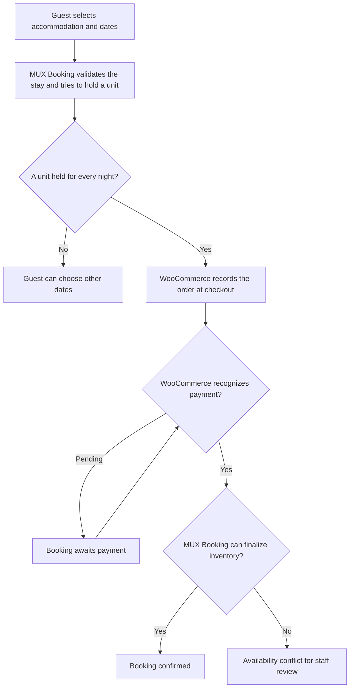

# Tamara Beach · MUX Booking

Tamara Beach is an Arabic, right-to-left resort website and booking storefront. Guests can browse villas and chalets, see how a stay is priced, and complete a reservation through WooCommerce. The site also presents resort information, dining menus, and ways to contact the resort. WordPress gives the resort team one place to manage the storefront, inventory, orders, and venue content.

| Who | What they can do |
| --- | --- |
| Overnight guests | Browse accommodation, choose dates, review a nightly estimate, and book through the storefront. |
| Activity guests | Choose a date and quantity for a configured activity or boat product. |
| Diners and visitors | Browse Pavilion and MOJO, open available menus, and start a WhatsApp conversation or send a resort inquiry. |
| Store staff | Manage rates, accommodation details, and daily unit capacity, and review booking status in WooCommerce. |
| Site administrators and content editors | Set up the site, maintain public information, and update homepage images, copy, and dining records with the appropriate WordPress permissions. |

## How a stay becomes a booking

The **Tamara Beach theme** provides the shopping and resort pages. The **MUX Booking plugin** adds dated products, stay inventory, booking status, and dining content. **WordPress** hosts both, and **WooCommerce** handles products, the cart, orders, and payment integration.

## Documentation

- [Project flow](PROJECT_FLOW.md) follows bookings, dining, and inquiries from first action to outcome.
- [Features](FEATURES.md) describes the public and administrative capabilities and their limits.
- [Implementation](IMPLEMENTATION.md) maps the packages, screens, storage, and integrations.
- [Run guide](RUN_GUIDE.md) covers setup, settings, and ways to try the workflows on staging.
- [Testing](TESTING.md) records completed checks, their results, and where fixtures were used.
